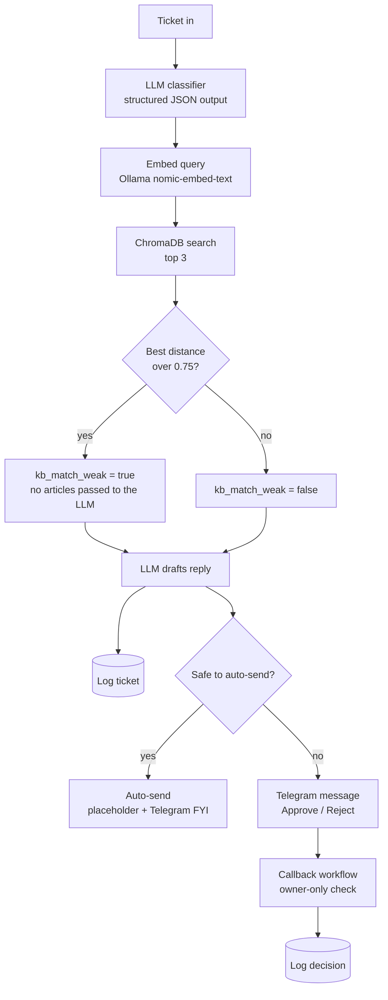

# Brightboard AI Support Agent

An n8n workflow that triages customer support tickets, drafts replies from a company knowledge base (RAG), and keeps a human in control of anything risky. Approval happens inside Telegram with a single tap.

Built as a hands-on project for AI automation: structured LLM output, retrieval with a quality guard, risk-based routing, human-in-the-loop approval, logging, and error alerting.

> **Status:** working prototype. The ticket input is a manual trigger and the "auto-send" step is a placeholder (see [Limitations](#limitations-and-roadmap)).

## What it does

1. **Classifies** each ticket into a category (`billing`, `refund`, `bug`, `account_access`, `how_to`, `feature_request`, `other`), a priority, and two risk flags: `needs_human` and `should_escalate`.
2. **Retrieves** the 3 most relevant help-center articles from ChromaDB.
3. **Checks retrieval quality.** If the best match is too distant, the ticket is flagged as having no knowledge-base match.
4. **Drafts a reply** using only the retrieved articles.
5. **Routes** the ticket:
   - Low-risk and well-covered: auto-handled, no approval needed.
   - Everything else: sent to Telegram with **Approve / Reject** buttons.
6. **Logs** every ticket and the human decision to an n8n Data table.
7. **Alerts** the owner in Telegram if any workflow fails.

## Architecture

### Auto-send rule

A reply is only sent without approval when **all** of these are true:

- `needs_human` is `false`
- `should_escalate` is `false`
- `kb_match_weak` is `false`
- the category is not `billing` or `refund`

The check is written to **fail safe**: if any field is missing or unexpected, the condition is false and the ticket goes to human approval.

## Key design decisions

| Decision                                                    | Why                                                                                                                                                                       |
| ----------------------------------------------------------- | ------------------------------------------------------------------------------------------------------------------------------------------------------------------------- |
| Money-related tickets always need approval                  | A wrong refund or billing statement has real cost. Policy decisions stay with a person.                                                                                   |
| Retrieval quality guard                                     | Chroma returns a distance (lower is better). Above 0.75, the draft prompt receives _no_ articles, so the model cannot be misled by unrelated text.                        |
| "Absence of information is not evidence" prompt rule        | Early tests showed the model saying a feature "does not exist" just because no article mentioned it. The prompt now forbids that and asks it to say it could not confirm. |
| No claims of actions taken                                  | The draft must never say it forwarded, escalated, or refunded anything, because the workflow does not do those things.                                                    |
| Telegram callback buttons instead of the Send and Wait node | The built-in approval uses URL buttons that open a browser page. Callback buttons keep the whole flow inside Telegram.                                                    |
| Separate workflow for button taps                           | A callback arrives as a brand-new execution, so a dedicated workflow listens for it.                                                                                      |
| Only the owner can tap                                      | The callback handler compares the sender's Telegram user ID before doing anything.                                                                                        |
| Temperature 0 on both LLM calls                             | More consistent classification and drafts.                                                                                                                                |
| Log first, send second                                      | Logging runs in parallel and continues on error, so a logging failure never blocks a ticket.                                                                              |

## Observed behavior

Manual tests during development (not a formal evaluation):

| Test ticket                            | Best distance | Result                                                                                                                |
| -------------------------------------- | ------------- | --------------------------------------------------------------------------------------------------------------------- |
| "How do I update my credit card?"      | 0.65          | KB match ok. Draft used only the retrieved steps and card brands.                                                     |
| "Do you have a dark mode on mobile?"   | 0.92          | No KB match. After the prompt fix, the draft says it could not confirm the feature and does not promise any action.   |
| Refund request (annual plan, 4 months) | 0.83          | Retrieved articles were about payments and plans, not refunds, which exposed a gap in retrieval for refund questions. |

These informed the 0.75 threshold. A proper labeled evaluation set is on the roadmap.

## Tech stack

- **n8n** (workflow orchestration)
- **Groq** `openai/gpt-oss-120b` (classification and drafting)
- **Ollama** `nomic-embed-text` (embeddings)
- **ChromaDB** (vector store, self-hosted)
- **Telegram Bot API** (approval and alerts)
- **n8n Data tables** (ticket log)

## Getting started

See [`workflows/README.md`](workflows/README.md) for step-by-step setup: credentials, importing the workflows, loading the knowledge base, and testing.

## Limitations and roadmap

**Current limitations**

- The input is a hardcoded manual trigger, not a real ticket source.
- The "Auto-send reply to customer" node is a placeholder that only posts an FYI to Telegram. Nothing is sent to a customer yet.
- Rejecting a draft only logs the decision. There is no regenerate flow.
- The classifier can be inconsistent on borderline tickets (for example `how_to` vs `feature_request`).
- Refund questions currently retrieve weakly, so the knowledge base needs a dedicated refund-policy article.
- No formal evaluation yet.

**Planned**

- [ ] Webhook trigger for incoming tickets
- [ ] Real reply sending (email or helpdesk API) with duplicate-send protection
- [ ] Evaluation set of 40 to 50 labeled tickets: category accuracy, recall on `needs_human`, and draft approval rate
- [ ] Regenerate button for rejected drafts
- [ ] Refund-policy article in the knowledge base
- [ ] `docker-compose` for n8n, ChromaDB, and Ollama

## Privacy

The workflow files in this repo contain no credentials, chat IDs, or instance identifiers. Ticket logs contain customer message text, so keep any real log data private and use sample tickets in demos.
