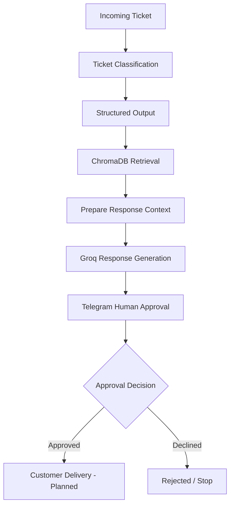
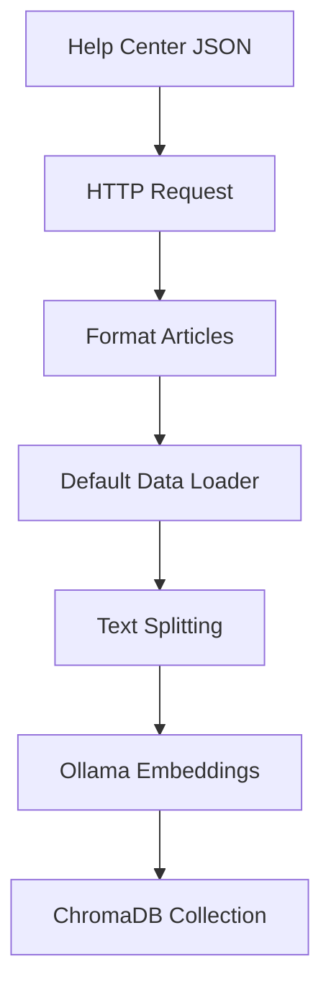

# Brightboard AI Support Agent

An AI-powered customer support automation system built with **n8n, Retrieval-Augmented Generation (RAG), ChromaDB, Ollama, and Groq**.

Brightboard AI Support Agent is designed to automate the initial stages of customer support: understanding incoming tickets, categorizing issues, retrieving relevant help-center information, and drafting context-aware responses.

A human reviewer remains in control of the final response through a Telegram-based approval workflow.

> **Project status:** Functional prototype under development. Ticket classification, knowledge-base ingestion, retrieval, response generation, and Telegram approval have been implemented and tested individually. End-to-end approval handling and customer delivery are still being completed.

---

## Table of Contents

- [Overview](#overview)
- [Features](#features)
- [Architecture](#architecture)
- [Technology Stack](#technology-stack)
- [How It Works](#how-it-works)
- [Knowledge Base and RAG](#knowledge-base-and-rag)
- [Human-in-the-Loop Approval](#human-in-the-loop-approval)
- [Example Ticket](#example-ticket)
- [Challenges and Engineering Decisions](#challenges-and-engineering-decisions)
- [Current Limitations](#current-limitations)
- [Roadmap](#roadmap)
- [Project Structure](#project-structure)
- [Security Notes](#security-notes)

---

## Overview

Traditional customer support systems often require agents to manually read tickets, identify the issue, search documentation, and write responses.

Brightboard aims to automate much of this repetitive work while retaining human oversight.

The system combines structured ticket classification with semantic knowledge retrieval and LLM-based response generation.

Instead of allowing an LLM to answer entirely from its pretrained knowledge, the system retrieves relevant company documentation and supplies it as context when generating a response.

Every generated response is intended to be reviewed before it reaches a customer.

## Features

### Ticket Classification

- Categorizes tickets into:
  - Billing
  - Refund
  - Bug
  - Account access
  - How-to
  - Feature request
  - Other
- Assigns a priority:
  - Low
  - Medium
  - High
- Determines whether human intervention is required.
- Identifies issues that should be escalated.

### Retrieval-Augmented Generation

- Retrieves relevant help-center articles from ChromaDB.
- Uses semantic search instead of relying only on keyword matching.
- Supplies retrieved documentation to the response-generation model.
- Limits company-policy answers to the provided knowledge base.

### AI Response Generation

- Generates professional, customer-facing draft responses.
- Addresses multiple concerns within the same ticket.
- Uses retrieved documentation as supporting context.
- Avoids claiming that actions have been completed when they have not.

### Human-in-the-Loop Approval

- Sends generated drafts to Telegram.
- Provides Approve and Decline options.
- Restricts approval to an authorized Telegram user.
- Uses the approval result to route the workflow.

### Knowledge-Base Ingestion

- Loads help-center articles from a JSON source.
- Formats article content and metadata.
- Splits documents into smaller chunks.
- Generates embeddings with Ollama.
- Stores vectors in ChromaDB.

---

## Architecture

### Main support workflow



### Knowledge ingestion workflow



The ingestion workflow and the ticket-processing workflow are separate conceptual processes. This prevents the knowledge base from being unnecessarily re-ingested every time a customer ticket is processed.

---

## Technology Stack

| Technology                           | Purpose                                                    |
| ------------------------------------ | ---------------------------------------------------------- |
| n8n                                  | Workflow orchestration and automation                      |
| Groq                                 | LLM inference                                              |
| GPT-OSS 120B (`openai/gpt-oss-120b`) | Ticket classification and response generation              |
| ChromaDB                             | Vector database                                            |
| Ollama                               | Local embedding generation                                 |
| `nomic-embed-text`                   | Text embedding model                                       |
| LangChain nodes                      | LLM chains, document loading, and vector-store integration |
| Telegram Bot API                     | Human approval interface                                   |
| Docker Desktop                       | Local container management                                 |
| GitHub                               | Source control and project documentation                   |

---

## How It Works

### 1. Ticket Input

The current development workflow uses an n8n Manual Trigger and an Edit Fields node to provide a test ticket.

A production ticket intake mechanism is planned.

### 2. Classification

The first LLM chain analyzes the ticket and returns structured information.

Example output:

```json
{
  "ticket_id": 8,
  "category": "refund",
  "priority": "medium",
  "needs_human": false,
  "should_escalate": false,
  "reasoning": "The customer requests a refund outside the standard eligibility window."
}
```

A Structured Output Parser is used to enforce the expected output format.

### 3. Knowledge Retrieval

The classified ticket is passed to ChromaDB.

The current retrieval configuration uses:

- Collection: `brightboard_knowledge_base`
- Embedding model: `nomic-embed-text:latest`
- Retrieval mode: Load
- Top K: 3 documents

The retrieved documents are combined into a knowledge context for the next stage.

### 4. Response Generation

Groq's `openai/gpt-oss-120b` generates a draft using:

- Original customer message
- Ticket category
- Ticket priority
- Retrieved help-center content

The prompt includes grounding rules to reduce unsupported policy claims and prevent the model from pretending that actions have already been completed.

### 5. Human Approval

The generated draft is sent to Telegram using n8n's Send and Wait for Response operation.

The approval configuration supports:

- Approve
- Disapprove / Decline
- Authorized approver restrictions

The returned decision contains an `approved` Boolean value.

Example:

```json
{
  "data": {
    "approved": true,
    "responder": {
      "id": "TELEGRAM_USER_ID",
      "source": "telegram"
    }
  }
}
```

A Switch node uses this value to separate approved and rejected tickets.

Customer delivery is not yet implemented.

---

## Knowledge Base and RAG

The project uses a JSON-based Brightboard help center.

Each article contains an identifier, title, and body.

During ingestion, article content is formatted into text documents and supplied to the Default Data Loader.

Current text-splitting configuration:

| Setting         |              Value |
| --------------- | -----------------: |
| Chunk size      |     700 characters |
| Chunk overlap   |     100 characters |
| Retrieval top K |                  3 |
| Embedding model | `nomic-embed-text` |
| Vector database |           ChromaDB |

The purpose of this approach is to retrieve relevant information without passing the entire knowledge base to the language model for every ticket.

Knowledge-base source:

[Brightboard Help Center JSON](https://github.com/naziwoprc/Brightboard-AI-Support-Agent/blob/main/help-center.json)

---

## Example Ticket

**Customer message:**

> Refund me. I bought the annual plan 4 months ago and the app is too slow.

The system identifies the primary category as `refund` and assigns medium priority.

The retrieval stage finds the refund policy article, which states that annual plans are eligible for a full refund within 30 days of purchase or renewal.

The response-generation stage must therefore:

1. Explain the standard refund eligibility window.
2. Avoid making the final refund decision.
3. Acknowledge the app-performance complaint.
4. Request relevant device and operating-system information.
5. Avoid claiming that a refund or escalation has already been processed.

The resulting response is sent for human review rather than directly to the customer.

---

## Challenges and Engineering Decisions

The project involved several practical issues beyond simply connecting AI nodes. The development log documents these in more detail.

Key engineering decisions included:

- Using `host.docker.internal` to connect n8n containers to services running on the host machine.
- Separating knowledge ingestion from ticket processing.
- Formatting JSON articles into actual document text before embedding.
- Using structured output for classification.
- Combining retrieved documents into a single context before response generation.
- Requiring human approval before customer delivery.
- Checking actual Telegram approval output instead of guessing the response field.

---

## Current Limitations

This is a development prototype, not a production-ready customer support service.

The following work remains:

- Complete and test the end-to-end approval and rejection branches.
- Preserve ticket information and generated drafts across the Telegram wait operation.
- Resolve Telegram button navigation so approval works directly inside Telegram.
- Finalize Telegram message formatting and parsing.
- Implement actual customer-response delivery.
- Replace the manual test trigger with a real ticket intake mechanism.
- Build a labeled evaluation dataset and measure classification and response quality.
- Add robust error handling, logging, and duplicate-ingestion protection.

---

## Roadmap

### Workflow Completion

- [x] Ticket classification
- [x] Structured classification output
- [x] Help-center ingestion workflow
- [x] ChromaDB retrieval
- [x] Response context preparation
- [x] AI draft generation
- [x] Telegram approval configuration
- [x] Approval / rejection routing configuration
- [ ] Preserve original ticket data across approval
- [ ] Verify both approval outcomes end to end
- [ ] Complete customer delivery

### Evaluation

- [ ] Prepare 75 labeled test tickets
- [ ] Measure classification accuracy
- [ ] Evaluate priority assignment
- [ ] Evaluate retrieval relevance
- [ ] Evaluate response grounding
- [ ] Measure unsupported claims and hallucinations
- [ ] Document evaluation results

### Production Readiness

- [ ] Real ticket intake
- [ ] Persistent ticket storage
- [ ] Retry and failure handling
- [ ] Logging and monitoring
- [ ] Secure credential management
- [ ] Deployment documentation

---

## Project Structure

The intended repository structure is:

```text
Brightboard-AI-Support-Agent/
│
├── README.md
│
├── workflows/
│   ├── support-agent.json
│   └── knowledge-ingestion.json
│
├── knowledge-base/
│   └── help-center.json
│
├── evaluation/
│   └── test-tickets.json
│
└── docs/
    ├── architecture.md
    └── development-log.md
```

Only add workflow exports and evaluation files after they have been validated and sanitized.

---

## Security Notes

- API keys and bot tokens must never be committed to GitHub.
- n8n credential references and exported workflow identifiers should be reviewed before publishing.
- Telegram chat IDs and personal identifiers should be replaced with placeholders in public examples.
- Local service URLs may need to be changed when deploying to another environment.
- The public repository should not contain n8n database files, backups, or `.env` files.

---

## Author

Developed as an AI engineering portfolio project to explore workflow automation, RAG systems, LLM integration, and human-in-the-loop AI applications.

**Repository:** [Brightboard AI Support Agent](https://github.com/naziwoprc/Brightboard-AI-Support-Agent)
